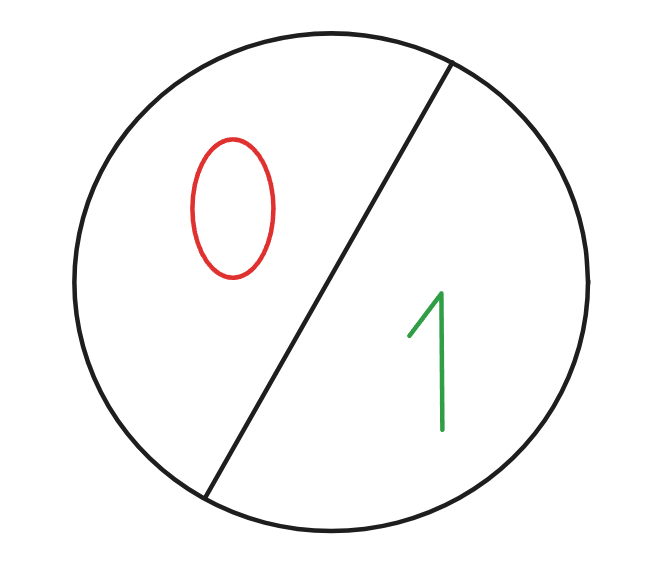

# Reconstructing McCulloch and Pitts (1943): A Computational and Mathematical Exploration

**A first-principles reconstruction of "A Logical Calculus of the Ideas Immanent in Nervous Activity"**

**Original paper:** Warren S. McCulloch and Walter H. Pitts (1943)  
**Publication:** *The Bulletin of Mathematical Biophysics*, Volume 5, pp. 115–133  
**Paper:** [A Logical Calculus of the Ideas Immanent in Nervous Activity](https://jontalle.web.engr.illinois.edu/uploads/410-NS.F22/McCulloch-Pitts-1943-neural-networks-ocr.pdf)

---

# 1. Why am I studying this paper?

When learning about artificial neural networks, it is easy to encounter concepts such as artificial neurons, activation functions, perceptrons, layers, weights, and eventually backpropagation without having a clear picture of how the underlying ideas developed. I have been studying deep learning for quite some time now, and while I and as anyone who is involved in this field of AI for good amount of time is well versed with these terminologies, I felt it essential to actually rediscover concepts myself from first principles. 

So, what did it mean to construct a mathematical model of a neuron in the first place? What even is a neuron? How did researchers begin connecting the activity of individual neurons to logical operations? And how did these early ideas lead to the possibility of representing increasingly complicated computations through networks of simple units?

The founding paper that addresses these questions is McCulloch and Pitts' 1943 work, *A Logical Calculus of the Ideas Immanent in Nervous Activity*.

I thought it would be a fruitful exercise to study this paper by attempting a computational and mathematical reconstruction of its central ideas. So this is exactly what in this repo I attempt to do.

I made an attempt to understand the reasoning behind the assumptions in the paper, reconstruct the mathematical arguments as far as I could, and implement computational models that allow me to test the behavior being described.

This repository serves as my research notebook throughout that process.

I have documented the original paper's relevant passages, my interpretation of them, the decisions I made while implementing the model, the experiments I ran, and the limitations I encountered and what they meant.

# 2. What am I trying to reconstruct?

The central idea of the paper is that, under a particular set of assumptions about neuronal activity, the behavior of neural networks can be described using propositional logic.

The authors begin with a model in which neuronal activity is an all-or-none process. Meaning, a neuron either produces an impulse or it does not. This allows its activity to be represented using a proposition that is either true or false. The relationships between neurons can then be expressed through logical operations.

For instance, depending on the arrangement of synapses and the excitation threshold of a neuron, its activity can depend on:

- Whether another neuron fires.
- Whether at least one of several neurons fires.
- Whether multiple neurons fire together.
- Whether an excitatory condition is satisfied while an inhibitory condition is absent.
- Whether a particular event occurred one or more synaptic delays earlier.

The paper develops a formal language for describing these relationships. It then investigates the relationship between logical expressions and networks capable of realizing them.

I reconstruct this connection computationally.

In particular, I investigated two complementary questions:

1. Given a neural network, how can I derive a logical expression describing its behavior?
2. Given a suitable logical expression, how can I construct a neural network that realizes it?

These questions guided much of the implementation.

## 2.1 What will count as a reconstruction?

For this project, I distinguished between three activities:

**Understanding:** Deriving the meaning of the paper's assumptions, definitions, equations, and theorems in my own words.

**Mathematical reconstruction:** Working through the reasoning behind selected results.

**Computational reconstruction:** Implementing the relevant mechanisms and constructions, then testing whether the resulting networks behave according to the mathematical descriptions.

A successful simulation of a few logical operations will not, by itself, established that I have reproduced the entire paper. I therefore, kept track of exactly which results I have implemented, tested, or derived.

# 3. A little background before getting started

Before looking at the paper's formal assumptions, I want to establish a few concepts that will appear repeatedly throughout the reconstruction. For obbvious reasons, these are not intended to be a comprehensive introduction to neuroscience or mathematical logic. They are the minimum conceptual foundations I need, to understand the model I am about to implement.

## 3.1 What is a neuron?

In biological sense, a neuron is a cell that receives signals from other neurons and can transmit an electrical impulse to other cells.


A handrawn diagram by me of a biological neuron (made with excalidraw)

The goal for me is to focus on a simplified representation of this process. A neuron receives inputs through connections called synapses. The incoming signals contribute to whether the neuron becomes active and produces an impulse of its own.

The model developed in the paper abstracts away many biological details. The purpose was to study the formal relationships between neuronal activity and the structure of a network. I will follow that abstraction.

## 3.2 What is a synapse?

A synapse is a junction through which one neuron influences another.

In the model considered here, I want to distinguish between two types of synaptic influence:

- **Excitatory:** Contributes toward causing the receiving neuron to fire. (Causes firing)
- **Inhibitory:** Prevents the receiving neuron from firing under the relevant assumptions. (Prevents firing)

A neuron can receive multiple excitatory and inhibitory inputs. Its activity depends on the arrangement of these inputs and its excitation threshold.

## 3.3 What does all-or-none activity mean?

For this model, neuronal activity is binary. Meaning, at a given time, a neuron either fires or does not fire.

We can represent these two possibilities using Boolean values:

| Neuronal activity | Boolean representation |
|---|---|
| Fires | `True` |
| Does not fire | `False` |

Reasoning about neuronal activity becomes easier using the language of propositions.

## 3.4 What is an excitation threshold?

A neuron does not necessarily fire whenever it receives an excitatory signal. The model assumes that a sufficient number of excitatory synapses must be active within the relevant period for the neuron to fire. Representation of this requirement is done using a threshold.

For instance, a neuron with three excitatory inputs and a threshold requiring two of them to be active gives us following:

| Active excitatory inputs | Fires? |
|---:|---|
| 0 | No |
| 1 | No |
| 2 | Yes |
| 3 | Yes |

This is only an illustrative example. The precise threshold convention used in the implementation will be documented separately.

## 3.5 Why does time matter?

Up until now we have established that the model is like a collection of neurons evaluating Boolean inputs at one instant. However, signals travel through synapses, and synaptic transmission takes time. Consequently, **the activity of a neuron at one time can depend on the activity of another neuron at an earlier time.**

We represent this "time" using discrete **steps**.

For example:

- At time \(t=0\), neuron A fires.
- At time \(t=1\), its signal reaches neuron B **if** the synaptic delay is one time step.
- At time \(t=2\), the signal may reach another neuron connected downstream.

This will eventually allow me to represent temporal relationships using logical expressions.

## 3.6 A brief introduction to propositional logic

A proposition is a statement that can be either true or false. Is grass green? True. Is the sky red? False. For this project, a statement such as

> Does a neuron A fire at time \(t\)?  can be represented by a proposition \(A(t)\).

Some basic logical operations appear throughout the paper:

| Operation | Symbol | Meaning |
|---|---|---|
| Negation | $\neg P$ | P is false |
| Disjunction | $P \lor Q$ | P or Q, or both |
| Conjunction | $P \land Q$ | Both P and Q |

These operations provide a language for describing the conditions under which neurons fire.

The paper extends this language to account for **time**.

# 4. The paper's assumptions


*I will initially focus on the consequences of these assumptions for networks without cycles. Later, I will investigate what changes when networks contain circular paths.*

# 5. From neuronal activity to logical expressions

If a neuron either fires or does not fire, its activity can be represented as a proposition.

Let: 

$N_i(t)$ represent the proposition that neuron $i$ fires at time $t$.

Then:

$$
N_i(t) =
\begin{cases}
1 & \text{if neuron } i \text{ fires at time } t,\\
0 & \text{otherwise}.
\end{cases}
$$

This gives me a way to describe the activity of a network using Boolean-valued functions of time.


Representation of a propositional neuron N.

The next question is how the activity of one neuron depends on the activity of other neurons.

Consider a few simple possibilities:

<div style="display: flex; gap: 20px; align-items: center;">
  
</div>

*The neuron N fires if neuron A fires.*

<div style="display: flex; gap: 20px; align-items: center;">
  
</div>


*The neuron N fires if either A or B fires.*

<div style="display: flex; gap: 20px; align-items: center;">
  
</div>

*The neuron N fires if both A and B fire.*

<div style="display: flex; gap: 20px; align-items: center;">
  
</div>

*The neuron N fires if A fires while B does not.*

Notice, in last case, B has veto here. Meaning it can prevent the firing of N even if A is firing. It's like a ANDNOT gate.

These correspond to logical relationships.

Now about timings. And the paper develops the idea by introducing a temporal operator.

## 5.1 The temporal shift operator

The paper introduces an operator \(S\).

Informally, $(S(P))$ represents a property that holds at the current time if $(P)$ held at the preceding time step.
<div style="display: flex; gap: 20px; align-items: center;">
  
</div>

I used the following modern notation to understand it:

$$
S(P)(t)=P(t-1)
$$

Repeated application of the operator allows me to refer to increasingly earlier events:

$$
S^2(P)(t)=P(t-2)
$$

$$
S^3(P)(t)=P(t-3)
$$

> To reiterate, neuronal activity is not only dependent on **which** inputs are active, but also on **when** those inputs were active.

This is the foundation of the temporal logic implementation. I will use it to decide how an expression should retrieve earlier neuronal activity from the simulation history.

## 5.2 Temporal propositional expressions

The authors define a formal class of expressions called temporal propositional expressions $(TPEs)$.

The grammar allows:

- A propositional variable.
- Temporal shifting.
- Disjunction.
- Conjunction.
- Conjunction with negation of another expression.

For the sake of simplicity and align with modern notation, the basic constructions can be written as:

$$
P
$$ 

$$
S(P)
$$

$$
P\lor Q
$$

$$
P\land Q
$$

$$
P\land\neg Q
$$


# 6. Code Implementation

I began by translating the idea of an individual neuron. Where the questions I overall wanted to answer were:

1. What information is required to determine whether a neuron fires?
2. How should excitatory inputs contribute to its activation?
3. How should inhibitory inputs affect its activation?
4. How should the excitation threshold be represented?
5. How can I test the behavior independently?

I did this by creating a `neuron.py` file and implemented the behavior as a simple function (the noob way). 

```python
def neuron(inputs, threshold):
    total = sum(inputs)

    if total >= threshold:
        return 1
    else:
        return 0
```
This is as simple as a neuron which takes inputs from some previous neurons and decides whether it will turn on or off on the basis of its threshold value. So we give `inputs` as previous neurons and `threshold` as a deciding factor as two parameter for this neuron function. 

For example, we can add three neuron's input and have a threshold that will, in some sense, tell us how many neurons are active. So, if we set a threshold as 2 and have the input sum and if the sum is equals to 1 then we can know that only 1 input neuron is active and other 2 our inactive. And our neuron won't fire. Or the function will return 0.

I then introduced inhibitory inputs. As we know, unlike excitatory inputs, which contribute towards reaching the firing threshold, an active inhibitory input prevents the neuron from firing, regardless of the total excitatory input received. I do this by simply adding a new parameter `inhibitory` and set it as `False` as default. Made it return `0` when `True` (fired).

```python
def neuron(inputs, threshold, inhibitory=False):
    if inhibitory:
        return 0

    total = sum(inputs)

    if total >= threshold:
        return 1
    else:
        return 0
```

Before introducing a more structured neuron implementation, I wanted to experiment with the firing condition itself.

I started with three binary inputs and enumerated all possible input combinations. By varying the threshold, I could observe how the neuron's output changed.

$$
N =
\begin{cases}
1 & \text{if } \displaystyle\sum_i x_i \geq \theta,\\
0 & \text{otherwise}.
\end{cases}
$$

I could reproduce familiar Boolean operations such as OR, AND, and the majority function.

I then experimented with alternative firing conditions.

Instead of requiring the input sum to exceed a threshold, I tried requiring it to equal or remain below a particular value.

<div style="display: flex; gap: 20px; align-items: center;">
  
</div>

This allowed me to explore additional functions, including exact-one detection, NOR, and NAND.

One particularly interesting experiment was XOR. For two inputs, requiring the input sum to equal one reproduces XOR exactly. However, extending this to three inputs revealed an important distinction between detecting exactly one active input and detecting an odd number of active inputs (parity).

Learning here was that the firing **condition** itself determines the class of Boolean functions a neuron can represent.

Point that was solidified here was that even tho I was able to implement XOR gate using a "neuron", it wasn't really a neuron in the conventional sense. Because the activation function depends a lot. And the conventional activation that we actually use is **>=** (greater than equals to). Circling back to our biological neuron definition: the neuron only fires when electrical impulses **crosses** certain threshold. Crossing actually defines the impossibility of implementing an XOR. Inequality matters for some reason.

When activation function is defined as strictly some value. That is, for 2 boolean inputs, when setting threshold as strictly equal to 1, we get firing condition for either of input neuron being fired. XOR function implemented. However, here we would rather refer to this more like a computation unit instead of calling it a neuron.

In this sense, I wondered then, whether a computational unit is actually limited in any way if we can manipulate the firing condition itself (the activation function)

Anyways, the paper describes excitation as exceeding a threshold, whereas an implementation can represent the same integer-count rule using a minimum required input count. So we are gonna roll with that.

Next, I made further enhancements in the neuron function: I gave `excitatory_inputs` and `inhibitory` inpust their distinct roles. Replaced if-else condition more sophisticatedly.

```python
def neuron(name, excitatory_inputs, inhibitory=False, threshold=1):
    if inhibitory:
        return 0

    total = sum(excitatory_inputs)

    return int(total >= threshold)
```

Similar experiments but with an inhibitory input $I$:
<div style="display: flex; gap: 20px; align-items: center;">
  
</div>

Having experimented with the basic firing mechanism, I wanted to move towards a more structured representation of an individual neuron. I gave this neuron class its own properties such as its identity and excitation threshold, which should persist independently of each firing evaluation. I therefore introduced a Neuron class using Python's `dataclass` decorator. Each neuron now has a name and a threshold, while its `fires()` method determines whether it produces an impulse based on the number of active excitatory inputs and the presence of an inhibitory input. 

```python
from dataclasses import dataclass

@dataclass(frozen=True)
class Neuron:
    name: str
    threshold: int = 1

    def fires(self, active_excitatory_count: int, inhibitory_active: bool) -> bool:
        if inhibitory_active:
            return False
        return active_excitatory_count >= self.threshold
```
I also used `frozen=True` to prevent a neuron's defining properties from being modified after its creation. This is a small but important transition: instead of treating a neuron as a function that processes inputs, I am now representing it as an individual computational unit with its own properties and firing behaviour.

---

# Stage 2 — Implementing synapses

I investigated how the delay affects the **time** at which a signal becomes available to the receiving neuron. For instance, if neuron A fires at time $t=0$ and its synapse has a delay of one time step, the signal should be available to neuron B at time $t=1$.

I created `synapse.py` to represent the **connections** through which neurons influence one another. I introduced two synapse types:

- Excitatory.
- Inhibitory.

Each synapse will need to store its source neuron, target neuron, type, and transmission delay.


**Deliverables:**

- A synapse representation.
- Excitatory and inhibitory synapse types.
- Configurable synaptic delays.
- Tests for signal propagation.

**Status:** Not started.

# Stage 3 — Constructing a neural network

**File:** `network.py`

**Objective:** Connect individual neurons and synapses into a network.

Now that I have individual neurons and their connections, I can construct a network.

The network will maintain:

- A collection of neurons.
- A collection of synapses.
- The activity history of each neuron.
- The current simulation time.

I will implement a discrete-time update procedure.

At each time step, the network will:

1. Receive external inputs.
2. Determine which incoming signals have arrived.
3. Count the active excitatory inputs.
4. Check whether any inhibitory input is active.
5. Determine the firing state of each neuron.
6. Record the resulting activity.

All neurons must be updated synchronously. A neuron being updated at time \(t\) must not accidentally use another neuron's newly computed state from that same time step when the connection should refer to an earlier time.

I will begin with small networks and gradually increase their complexity.

**Deliverables:**

- A `Network` class.
- Methods to add neurons and synapses.
- A discrete-time update method.
- Tests for simple network configurations.

**Status:** Not started.

# Stage 4 — Simulating network activity

**File:** `simulation.py`

**Objective:** Run networks over sequences of external inputs and inspect their behavior.

I now need a convenient way to run experiments.

Rather than manually advancing a network one time step at a time, I will create a simulation interface that accepts an input schedule and a number of time steps.

I want to inspect the activity of every neuron over time.

A simple table should be sufficient initially:

| Time | Neuron A | Neuron B | Neuron C |
|---:|---:|---:|---:|
| 0 | 1 | 0 | 0 |
| 1 | 0 | 1 | 0 |
| 2 | 0 | 0 | 1 |

The values above are illustrative. The actual output will depend on the network being simulated.

**Deliverables:**

- A simulation function.
- Input scheduling.
- Activity-history collection.
- A readable trace of neuronal activity.

**Status:** Not started.

# Stage 5 — Implementing temporal propositional logic

**Directory:** `logic/`

**Files:**

- `logic/expressions.py`
- `logic/temporal_logic.py`

**Objective:** Represent and evaluate the temporal propositional expressions introduced in the paper.

At this point, I will have a working network simulator. I now want a separate representation of the logical expressions that describe network behavior.

I will begin with the basic expression types:

- Variables.
- Temporal shifts.
- Disjunction.
- Conjunction.
- Conjunction with negation.

I will represent expressions using Python classes, forming an expression tree.

The evaluator will need access to the activity history of the relevant neurons.

For example:

\[
S(P\land\neg Q)
\]

should be evaluated using the values of \(P\) and \(Q\) at the preceding time step.

I will also decide how to handle times before the beginning of a simulation. Initially, I may use a false-valued initial history, but I will document this as a simulation convention rather than assume that it is a universal rule of the original paper.

**Deliverables:**

- Expression classes.
- Temporal shift evaluation.
- Boolean operator evaluation.
- Tests for nested temporal expressions.

**Status:** Not started.

# Stage 6 — Reconstructing Figures 1a–1d

**Directory:** `experiments/`

**Files:**

- `experiments/figure_1a.py`
- `experiments/figure_1b.py`
- `experiments/figure_1c.py`
- `experiments/figure_1d.py`

**Objective:** Reconstruct the elementary network constructions used in Theorem II.

Theorem II states that every TPE is realizable by a network of order zero.

The authors use four fundamental network constructions in Figures 1a–1d.

These correspond to:

| Figure | Logical expression |
|---|---|
| 1a | \(S(P_1)\) |
| 1b | \(S(P_1\lor P_2)\) |
| 1c | \(S(P_1\land P_2)\) |
| 1d | \(S(P_1\land\neg P_2)\) |

I will reconstruct each one independently.

For every figure, I will:

1. Examine the original diagram.
2. Identify its inputs, neurons, synapses, and delays.
3. Write down the logical expression it is intended to realize.
4. Construct the corresponding network.
5. Test different input combinations.
6. Evaluate the logical expression independently.
7. Compare the network output with the logical output.

I will not assume that implementing the correct input-output function automatically means I have reproduced the exact topology shown in the original figure. I will compare my construction with the paper's diagrams and document any differences.

**[INSERT SCREENSHOT: Original paper, page 7, Figures 1a–1d]**

*Why I am including this passage:* These diagrams provide the concrete network constructions that I will attempt to reproduce and test.

**Deliverables:**

- Four network constructions.
- Tests for each construction.
- Comparisons between network outputs and logical evaluations.
- Notes on any differences from the original diagrams.

**Status:** Not started.

# Stage 7 — Reconstructing the thermal illusion

**File:** `experiments/thermal_illusion.py`

**Objective:** Reconstruct the paper's example of heat sensation produced by transient cooling.

The paper provides an example involving two types of cutaneous receptors: one associated with heat and another associated with cold.

The authors describe a situation in which briefly applying a cold object to the skin can produce a sensation of heat, whereas applying it for a longer period produces a sensation of cold.

They express the required behavior using temporal propositional expressions and then construct a network using the fundamental elements from Figures 1a–1d.

I will investigate this example as an integration test of the simulator and temporal logic implementation.

The equations, expressed in modern notation, are:

\[
N_3(t)=N_1(t-1)\lor
\left[N_2(t-3)\land\neg N_2(t-2)\right]
\]

\[
N_4(t)=N_2(t-2)\land N_2(t-1)
\]

Here:

- \(N_1\) represents heat receptor activity.
- \(N_2\) represents cold receptor activity.
- \(N_3\) represents the heat-sensation output.
- \(N_4\) represents the cold-sensation output.

I will first implement these equations directly using the temporal logic evaluator.

Then I will construct a neural network that realizes the same behavior.

This gives me two independent ways of calculating the expected output, which I can compare.

**[INSERT SCREENSHOT: Original paper, pages 8–9, thermal illusion example and network construction]**

*Why I am including this passage:* This example demonstrates how the authors use temporal logical expressions to specify a behavior and then construct a network that realizes it.

**Deliverables:**

- Direct implementation of the equations.
- Short and long cooling input experiments.
- A network construction.
- Comparison between logical and simulated outputs.

**Status:** Not started.

# Stage 8 — Reconstructing Theorem I

**Objective:** Translate a network of order zero into temporal propositional expressions.

Theorem I states:

> Every net of order 0 can be solved in terms of temporal propositional expressions.

I want to understand the proof before attempting to automate it.

The central idea is to express the firing condition of a neuron in terms of the activity of the neurons connected to it.

For a neuron with multiple excitatory inputs and inhibitory inputs, its firing condition can be represented as a finite disjunction of qualifying combinations of excitatory inputs, with inhibitory conditions accounted for.

Because a network of order zero has no cycles, I should be able to repeatedly substitute expressions for upstream neurons until I obtain an expression in terms of the peripheral afferents.

I will first work through a small example manually.

Only after understanding the substitution process will I implement a network-to-expression translator.

**[INSERT SCREENSHOT: Original paper, page 6, Theorem I and its proof]**

*Why I am including this passage:* This is the central construction I need to understand before implementing the translator.

**Deliverables:**

- A manually derived example.
- An explanation of the substitution procedure.
- A network-to-TPE translator.
- Tests comparing the resulting expression with network behavior.

**Status:** Not started.

# Stage 9 — Reconstructing Theorem II

**Objective:** Construct a network from a temporal propositional expression.

Theorem II states:

> Every TPE is realizable by a net of order zero.

This is the reverse direction of Theorem I.

The four fundamental constructions from Figures 1a–1d provide the building blocks.

I will investigate how larger expressions can be constructed by combining smaller networks.

For example, if I can construct networks for two expressions, how can I combine them to construct a network for their conjunction or disjunction?

I will begin with manually constructed examples before attempting to automate the process.

The eventual goal is an expression-to-network compiler.

**[INSERT SCREENSHOT: Original paper, pages 6–7, Theorem II and its proof]**

*Why I am including this passage:* This proof explains how the fundamental network constructions can be combined to realize arbitrary expressions generated by the TPE grammar.

**Deliverables:**

- Manually constructed examples.
- A reusable composition procedure.
- An expression-to-network compiler.
- Tests comparing the compiled network with direct expression evaluation.

**Status:** Not started.

# Stage 10 — Reconstructing Theorem III

**Objective:** Investigate the paper's characterization of temporal propositional expressions.

Theorem III provides a condition for determining whether an expression built from propositional variables and logical operations qualifies as a TPE.

The paper relates this condition to truth tables and Hilbert disjunctive normal form.

I will work through the statement and proof before implementing any test.

I want to understand:

- What the condition says.
- Why it is necessary.
- Why it is sufficient.
- How it relates to the TPE grammar.
- Whether I can construct examples that satisfy or violate the condition.

I will then write small programs to evaluate finite expressions and compare the results with the grammar-based construction.

The computational tests will support my understanding, but they will not replace the general mathematical proof.

**[INSERT SCREENSHOT: Original paper, page 7, Theorem III]**

**Deliverables:**

- A mathematical explanation of the characterization.
- Worked examples.
- A truth-table-based experiment.
- Tests for selected expressions.

**Status:** Not started.

# Stage 11 — Investigating Theorems IV–VII

**Objective:** Investigate the equivalences between different assumptions about neuronal behavior.

After establishing the relationship between networks and temporal propositional expressions, the paper considers several alternative physiological assumptions.

The authors investigate whether different assumptions can be represented by equivalent networks, potentially with different timing.

The results include:

| Theorem | Subject |
|---|---|
| IV | Relative and absolute inhibition are equivalent in the extended sense. |
| V | Extinction is equivalent to absolute inhibition. |
| VI | Facilitation and temporal summation may be replaced by spatial summation. |
| VII | Alterable synapses can be replaced by circles. |

I will approach these results individually.

For each one, I will identify the original assumption, the alternative assumption, and the construction used to establish equivalence.

Where possible, I will implement small networks under both assumptions and compare their behavior.

I will be careful not to assume that equivalence means identical network structure or identical timing. The paper's definition allows for a different realizing network and differences in time.

**[INSERT SCREENSHOTS: Original paper, pages 9–11, Theorems IV–VII]**

**Deliverables:**

- A separate explanation of each theorem.
- Small example networks.
- Comparisons of input-output behavior.
- Notes on timing and structural differences.

**Status:** Not started.

# Stage 12 — Investigating cyclic networks

**Objective:** Extend the reconstruction to networks containing circular paths.

The earlier results concern networks without cycles.

The paper then introduces cyclic networks, in which activity can propagate around a circuit and regenerate activity in neurons that participated in the circuit.

This changes the nature of the problem.

In an acyclic network, repeated substitution eventually reaches the peripheral inputs. In a cyclic network, the dependence on previous activity can extend indefinitely into the past.

The authors introduce recursive functions to describe these more complicated relationships.

I will need to understand this formalism before extending the simulator.

I expect this stage to require additional machinery for representing and investigating cyclic behavior.

**[INSERT SCREENSHOT: Original paper, pages 11 onward, definition and discussion of cyclic networks]**

**Deliverables:**

- A precise definition of a cyclic network in my own words.
- Examples of networks containing cycles.
- A study of the recursive descriptions used in the paper.
- An extension of the simulator where necessary.

**Status:** Not started.

# Stage 13 — Reconstructing Theorems VIII–X

**Objective:** Investigate the paper's results concerning cyclic networks and recursive functions.

I will work through these theorems after understanding the preceding definitions and constructions.

For each theorem, I will record:

- The exact statement.
- The definitions required to understand it.
- The proof strategy.
- Any constructions or examples provided by the authors.
- What I can reproduce computationally.
- What remains a mathematical argument rather than a simulation.

I will not claim to have reproduced a theorem merely because I have implemented an example related to it.

**Deliverables:**

- Worked notes for Theorems VIII–X.
- Relevant computational experiments.
- A record of which proof steps I have independently reconstructed.

**Status:** Not started.

# 7. Implementation principles

Throughout this project, I want the implementation to remain faithful to the mathematical model while keeping the code understandable.

I will follow a few principles.

## 7.1 Build from simple components

I will not begin with a large framework or a neural-network library.

The basic mechanisms should be implemented directly in Python so that I can inspect exactly how each neuron, synapse, and time step works.

## 7.2 Separate the simulator from the logic

The neural network simulator and the temporal logic evaluator should be independent components.

This is important because I want to compare their outputs.

If a network and its corresponding expression produce different results, I should be able to investigate the discrepancy without one implementation depending on the other.

## 7.3 Test every component independently

I will write tests for individual neurons, synapses, networks, and logical expressions.

For more complex constructions, I will compare the output of the simulated network against the output predicted by the corresponding logical expression.

## 7.4 Preserve the original assumptions

Whenever I simplify or reinterpret something for implementation purposes, I will document it.

For example, a discrete-time simulator needs a convention for the initial state before time zero. That convention should not be confused with a claim made explicitly by the original paper.

## 7.5 Distinguish reproduction from extension

If I introduce an additional feature that is useful for the implementation but is not part of the paper's original model, I will identify it as an implementation choice or extension.

# 8. Reproduction progress

I will use this table to keep track of the actual progress of the project.

| Component / result | Status |
|---|---|
| Project setup and research notes | Not started |
| Individual neuron | Not started |
| Excitatory and inhibitory synapses | Not started |
| Synaptic delays | Not started |
| Discrete-time network simulator | Not started |
| Simulation interface | Not started |
| Temporal propositional expressions | Not started |
| Figures 1a–1d | Not started |
| Thermal illusion | Not started |
| Theorem I | Not started |
| Theorem II | Not started |
| Theorem III | Not started |
| Theorems IV–VII | Not started |
| Cyclic networks | Not started |
| Theorems VIII–X | Not started |

I will update these statuses only when I have completed the relevant implementation, derivation, or experiment.

# 9. What I want to learn from this reconstruction

By the end of this project, I want to be able to explain the paper's central ideas without relying on a high-level summary.

More specifically, I want to understand:

1. How binary neuronal activity can be represented using propositions.
2. How synaptic connections and excitation thresholds give rise to logical relationships.
3. Why temporal information is necessary to describe neuronal networks.
4. How temporal propositional expressions are constructed.
5. How networks without cycles can be described using these expressions.
6. How logical expressions can be realized through networks.
7. Why the authors investigate equivalences between different physiological assumptions.
8. How circular paths introduce recursive behavior.
9. What the paper establishes about the relationship between neural networks, logic, and computation.

I also want to become more comfortable translating mathematical descriptions into executable models and using computational experiments to investigate theoretical claims.

# 10. References and working material

**Primary source**

McCulloch, W. S., & Pitts, W. (1943). *A Logical Calculus of the Ideas Immanent in Nervous Activity*. Bulletin of Mathematical Biophysics, 5, 115–133.

[Read the original paper (PDF)](https://jontalle.web.engr.illinois.edu/uploads/410-NS.F22/McCulloch-Pitts-1943-neural-networks-ocr.pdf)

**Working conventions**

- I will use modern mathematical notation where it improves readability, while preserving the meaning of the original paper.
- I will identify when a statement is taken directly from the paper and when it is my own interpretation.
- Screenshots inserted throughout this README will refer to the corresponding sections of the original paper.
- Computational results will be reported with the input conditions, implementation assumptions, and tests used to obtain them.

---

*This is a work in progress. I am using the reconstruction process itself as a way to understand the paper, so the explanations, implementation decisions, experiments, and conclusions will develop as I work through it.*