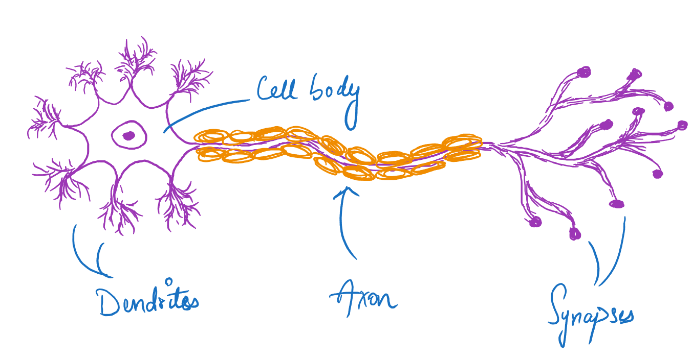
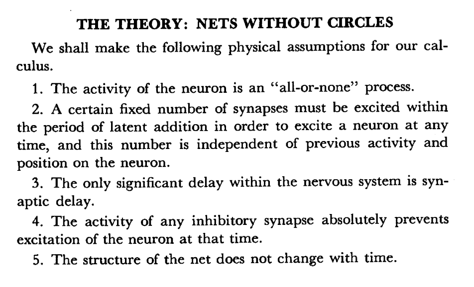
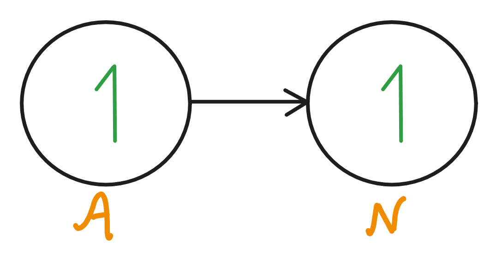

# Reconstructing McCulloch and Pitts (1943): A Computational and Mathematical Exploration

**A first-principles reconstruction of "A Logical Calculus of the Ideas Immanent in Nervous Activity"**

**Original paper:** Warren S. McCulloch and Walter H. Pitts (1943)  
**Publication:** *The Bulletin of Mathematical Biophysics*, Volume 5, pp. 115–133  
**Paper:** [A Logical Calculus of the Ideas Immanent in Nervous Activity](https://jontalle.web.engr.illinois.edu/uploads/410-NS.F22/McCulloch-Pitts-1943-neural-networks-ocr.pdf)

---

# 1. Why am I studying this paper?

When learning about artificial neural networks, it is easy to encounter concepts such as artificial neurons, activation functions, perceptrons, layers, weights, and eventually backpropagation without having a clear picture of how the underlying ideas developed. I have been studying deep learning for quite some time now, and while I and as anyone who is involved in this field of AI for good amount of time is well versed with these terminologies, I felt it essential to actually rediscover concepts myself from first principles. 

So, what did it mean to construct a mathematical model of a neuron in the first place? What even is a neuron? How did researchers begin connecting the activity of individual neurons to logical operations? And how did these early ideas lead to the possibility of representing increasingly complicated computations through networks of simple units?

The founding paper that addresses these questions is McCulloch and Pitts' 1943 work, *A Logical Calculus of the Ideas Immanent in Nervous Activity*.

I thought it would be a fruitful exercise to study this paper by attempting a computational and mathematical reconstruction of its central ideas. So this is exactly what in this repo I attempt to do.

I made an attempt to understand the reasoning behind the assumptions in the paper, reconstruct the mathematical arguments as far as I could, and implement computational models that allow me to test the behavior being described.

This repository serves as my research notebook throughout that process.

I have documented the original paper's relevant passages, my interpretation of them, the decisions I made while implementing the model, the experiments I ran, and the limitations I encountered and what they meant.

# 2. What am I trying to reconstruct?

The central idea of the paper is that, under a particular set of assumptions about neuronal activity, the behavior of neural networks can be described using propositional logic.

The authors begin with a model in which neuronal activity is an all-or-none process. Meaning, a neuron either produces an impulse or it does not. This allows its activity to be represented using a proposition that is either true or false. The relationships between neurons can then be expressed through logical operations.

For instance, depending on the arrangement of synapses and the excitation threshold of a neuron, its activity can depend on:

- Whether another neuron fires.
- Whether at least one of several neurons fires.
- Whether multiple neurons fire together.
- Whether an excitatory condition is satisfied while an inhibitory condition is absent.
- Whether a particular event occurred one or more synaptic delays earlier.

The paper develops a formal language for describing these relationships. It then investigates the relationship between logical expressions and networks capable of realizing them.

I reconstruct this connection computationally.

In particular, I investigated two complementary questions:

1. Given a neural network, how can I derive a logical expression describing its behavior?
2. Given a suitable logical expression, how can I construct a neural network that realizes it?

These questions guided much of the implementation.

## 2.1 What will count as a reconstruction?

For this project, I distinguished between three activities:

**Understanding:** Deriving the meaning of the paper's assumptions, definitions, equations, and theorems in my own words.

**Mathematical reconstruction:** Working through the reasoning behind selected results.

**Computational reconstruction:** Implementing the relevant mechanisms and constructions, then testing whether the resulting networks behave according to the mathematical descriptions.

A successful simulation of a few logical operations will not, by itself, established that I have reproduced the entire paper. I therefore, kept track of exactly which results I have implemented, tested, or derived.

# 3. A little background before getting started

Before looking at the paper's formal assumptions, I want to establish a few concepts that will appear repeatedly throughout the reconstruction. For obbvious reasons, these are not intended to be a comprehensive introduction to neuroscience or mathematical logic. They are the minimum conceptual foundations I need, to understand the model I am about to implement.

## 3.1 What is a neuron?

In biological sense, a neuron is a cell that receives signals from other neurons and can transmit an electrical impulse to other cells.


A handrawn diagram by me of a biological neuron (made with excalidraw)

The goal for me is to focus on a simplified representation of this process. A neuron receives inputs through connections called synapses. The incoming signals contribute to whether the neuron becomes active and produces an impulse of its own.

The model developed in the paper abstracts away many biological details. The purpose was to study the formal relationships between neuronal activity and the structure of a network. I will follow that abstraction.

## 3.2 What is a synapse?

A synapse is a junction through which one neuron influences another.

In the model considered here, I want to distinguish between two types of synaptic influence:

- **Excitatory:** Contributes toward causing the receiving neuron to fire. (Causes firing)
- **Inhibitory:** Prevents the receiving neuron from firing under the relevant assumptions. (Prevents firing)

A neuron can receive multiple excitatory and inhibitory inputs. Its activity depends on the arrangement of these inputs and its excitation threshold.

## 3.3 What does all-or-none activity mean?

For this model, neuronal activity is binary. Meaning, at a given time, a neuron either fires or does not fire.

We can represent these two possibilities using Boolean values:

| Neuronal activity | Boolean representation |
|---|---|
| Fires | `True` |
| Does not fire | `False` |

Reasoning about neuronal activity becomes easier using the language of propositions.

## 3.4 What is an excitation threshold?

A neuron does not necessarily fire whenever it receives an excitatory signal. The model assumes that a sufficient number of excitatory synapses must be active within the relevant period for the neuron to fire. Representation of this requirement is done using a threshold.

For instance, a neuron with three excitatory inputs and a threshold requiring two of them to be active gives us following:

| Active excitatory inputs | Fires? |
|---:|---|
| 0 | No |
| 1 | No |
| 2 | Yes |
| 3 | Yes |

This is only an illustrative example. The precise threshold convention used in the implementation will be documented separately.

## 3.5 Why does time matter?

Up until now we have established that the model is like a collection of neurons evaluating Boolean inputs at one instant. However, signals travel through synapses, and synaptic transmission takes time. Consequently, **the activity of a neuron at one time can depend on the activity of another neuron at an earlier time.**

We represent this "time" using discrete **steps**.

For example:

- At time \(t=0\), neuron A fires.
- At time \(t=1\), its signal reaches neuron B **if** the synaptic delay is one time step.
- At time \(t=2\), the signal may reach another neuron connected downstream.

This will eventually allow me to represent temporal relationships using logical expressions.

## 3.6 A brief introduction to propositional logic

A proposition is a statement that can be either true or false. Is grass green? True. Is the sky red? False. For this project, a statement such as

> Does a neuron A fire at time \(t\)?  can be represented by a proposition \(A(t)\).

Some basic logical operations appear throughout the paper:

| Operation | Symbol | Meaning |
|---|---|---|
| Negation | $\neg P$ | P is false |
| Disjunction | $P \lor Q$ | P or Q, or both |
| Conjunction | $P \land Q$ | Both P and Q |

These operations provide a language for describing the conditions under which neurons fire.

The paper extends this language to account for **time**.

# 4. The paper's assumptions



*I will initially focus on the consequences of these assumptions for networks without cycles. Later, I will investigate what changes when networks contain circular paths.*

# 5. From neuronal activity to logical expressions

If a neuron either fires or does not fire, its activity can be represented as a proposition.

Let: 

$N_i(t)$ represent the proposition that neuron $i$ fires at time $t$.

Then:

$$
N_i(t) =
\begin{cases}
1 & \text{if neuron } i \text{ fires at time } t,\\
0 & \text{otherwise}.
\end{cases}
$$

This gives me a way to describe the activity of a network using Boolean-valued functions of time.


Representation of a propositional neuron N.

The next question is how the activity of one neuron depends on the activity of other neurons.

Consider a few simple possibilities:

<div style="display: flex; gap: 20px; align-items: center;">
  
</div>

*The neuron N fires if neuron A fires.*

<div style="display: flex; gap: 20px; align-items: center;">
  
</div>


*The neuron N fires if either A or B fires.*

<div style="display: flex; gap: 20px; align-items: center;">
  
</div>

*The neuron N fires if both A and B fire.*

<div style="display: flex; gap: 20px; align-items: center;">
  
</div>

*The neuron N fires if A fires while B does not.*

Notice, in last case, B has veto here. Meaning it can prevent the firing of N even if A is firing. It's like a ANDNOT gate.

These correspond to logical relationships.

Now about timings. And the paper develops the idea by introducing a temporal operator.

## 5.1 The temporal shift operator

The paper introduces an operator \(S\).

Informally, $(S(P))$ represents a property that holds at the current time if $(P)$ held at the preceding time step.
<div style="display: flex; gap: 20px; align-items: center;">
  
</div>

I used the following modern notation to understand it:

$$
S(P)(t)=P(t-1)
$$

Repeated application of the operator allows me to refer to increasingly earlier events:

$$
S^2(P)(t)=P(t-2)
$$

$$
S^3(P)(t)=P(t-3)
$$

> To reiterate, neuronal activity is not only dependent on **which** inputs are active, but also on **when** those inputs were active.

This is the foundation of the temporal logic implementation. I will use it to decide how an expression should retrieve earlier neuronal activity from the simulation history.

## 5.2 Temporal propositional expressions

The authors define a formal class of expressions called temporal propositional expressions $(TPEs)$.

The grammar allows:

- A propositional variable.
- Temporal shifting.
- Disjunction.
- Conjunction.
- Conjunction with negation of another expression.

For the sake of simplicity and align with modern notation, the basic constructions can be written as:

$$
P
$$ 

$$
S(P)
$$

$$
P\lor Q
$$

$$
P\land Q
$$

$$
P\land\neg Q
$$


# 6. Code Implementation

I began by translating the idea of an individual neuron. Where the questions I overall wanted to answer were:

1. What information is required to determine whether a neuron fires?
2. How should excitatory inputs contribute to its activation?
3. How should inhibitory inputs affect its activation?
4. How should the excitation threshold be represented?
5. How can I test the behavior independently?

I did this by creating a `neuron.py` file and implemented the behavior as a simple function (the noob way). 

```python
def neuron(inputs, threshold):
    total = sum(inputs)

    if total >= threshold:
        return 1
    else:
        return 0
```
This is as simple as a neuron which takes inputs from some previous neurons and decides whether it will turn on or off on the basis of its threshold value. So we give `inputs` as previous neurons and `threshold` as a deciding factor as two parameter for this neuron function. 

For example, we can add three neuron's input and have a threshold that will, in some sense, tell us how many neurons are active. So, if we set a threshold as 2 and have the input sum and if the sum is equals to 1 then we can know that only 1 input neuron is active and other 2 our inactive. And our neuron won't fire. Or the function will return 0.

I then introduced inhibitory inputs. As we know, unlike excitatory inputs, which contribute towards reaching the firing threshold, an active inhibitory input prevents the neuron from firing, regardless of the total excitatory input received. I do this by simply adding a new parameter `inhibitory` and set it as `False` as default. Made it return `0` when `True` (fired).

```python
def neuron(inputs, threshold, inhibitory=False):
    if inhibitory:
        return 0

    total = sum(inputs)

    if total >= threshold:
        return 1
    else:
        return 0
```

Before introducing a more structured neuron implementation, I wanted to experiment with the firing condition itself.

I started with three binary inputs and enumerated all possible input combinations. By varying the threshold, I could observe how the neuron's output changed.

$$
N =
\begin{cases}
1 & \text{if } \displaystyle\sum_i x_i \geq \theta,\\
0 & \text{otherwise}.
\end{cases}
$$

I could reproduce familiar Boolean operations such as OR, AND, and the majority function.

I then experimented with alternative firing conditions.

Instead of requiring the input sum to exceed a threshold, I tried requiring it to equal or remain below a particular value.

<div style="display: flex; gap: 20px; align-items: center;">
  
</div>

This allowed me to explore additional functions, including exact-one detection, NOR, and NAND.

One particularly interesting experiment was XOR. For two inputs, requiring the input sum to equal one reproduces XOR exactly. However, extending this to three inputs revealed an important distinction between detecting exactly one active input and detecting an odd number of active inputs (parity).

Learning here was that the firing **condition** itself determines the class of Boolean functions a neuron can represent.

Point that was solidified here was that even tho I was able to implement XOR gate using a "neuron", it wasn't really a neuron in the conventional sense. Because the activation function depends a lot. And the conventional activation that we actually use is **>=** (greater than equals to). Circling back to our biological neuron definition: the neuron only fires when electrical impulses **crosses** certain threshold. Crossing actually defines the impossibility of implementing an XOR. Inequality matters for some reason.

When activation function is defined as strictly some value. That is, for 2 boolean inputs, when setting threshold as strictly equal to 1, we get firing condition for either of input neuron being fired. XOR function implemented. However, here we would rather refer to this more like a computation unit instead of calling it a neuron.

In this sense, I wondered then, whether a computational unit is actually limited in any way if we can manipulate the firing condition itself (the activation function)

Anyways, the paper describes excitation as exceeding a threshold, whereas an implementation can represent the same integer-count rule using a minimum required input count. So we are gonna roll with that.

Next, I made further enhancements in the neuron function: I gave `excitatory_inputs` and `inhibitory` inpust their distinct roles. Replaced if-else condition more sophisticatedly.

```python
def neuron(name, excitatory_inputs, inhibitory=False, threshold=1):
    if inhibitory:
        return 0

    total = sum(excitatory_inputs)

    return int(total >= threshold)
```

Similar experiments but with an inhibitory input $I$:
<div style="display: flex; gap: 20px; align-items: center;">
  
</div>

Having experimented with the basic firing mechanism, I wanted to move towards a more structured representation of an individual neuron. I gave this neuron class its own properties such as its identity and excitation threshold, which should persist independently of each firing evaluation. I therefore introduced a Neuron class using Python's `dataclass` decorator. Each neuron now has a name and a threshold, while its `fires()` method determines whether it produces an impulse based on the number of active excitatory inputs and the presence of an inhibitory input. 

```python
from dataclasses import dataclass

@dataclass(frozen=True)
class Neuron:
    name: str
    threshold: int = 1

    def fires(self, active_excitatory_count: int, inhibitory_active: bool) -> bool:
        if inhibitory_active:
            return False
        return active_excitatory_count >= self.threshold
```
I also used `frozen=True` to prevent a neuron's defining properties from being modified after its creation. This is a small but important transition: instead of treating a neuron as a function that processes inputs, I am now representing it as an individual computational unit with its own properties and firing behaviour.

---

# Stage 2 — Implementing synapses

We understand that a neuron is not operating in isolation. It receives signals from other units through connections called synapses. 

<div style="display: flex; gap: 20px; align-items: center;">
  
</div>
For our simulation, a synapse represents a directed connection between two units (source and target):
- A source: where the signal originates.
- A target: where the signal is delivered.

Two additional properties a synapse possesses are its type and delay:

- A type or kind: whether the connection is excitatory or inhibitory.
- A delay: how many time steps it takes for the signal to arrive.

Also, the connection from A to B is not necessarily equivalent to the connection from B to A. This means we must treat connections as directed edges.


I created `synapse.py` and defined a class:

```python
class Synapses:
  def __innit__(self, source, target, kind, delay):
    self.source = source
    self.target = target
    self.kind = kind
    self.delay = delay
```

I can instantiate this as:
```python
connection1 = Synapse("N1", "N2", "excitatory", 1)
connection2 = Synapse("N2", "N3", "inhibitory", 2)
```
I needed to make sure `kind` only takes restricted values (either `excitatory` or `inhibitory`) and use `frozen=True` of `@dataclass` decorator to prevent accidental modification.

```python
from enum import Enum

class SynapseType(str, Enum):
    EXCITATORY = "excitatory"
    INHIBITORY = "inhibitory"

@dataclass(frozen=True)
class Synapse:
    source: str
    target: str
    kind: SynapseType = SynapseType.EXCITATORY
    delay: int = 1
```
There are still some invalid configurations I need to prevent. 
- A synapse cannot have an empty source or target.
- A synaptic delay must be atleast one time step.
- The synapse type must be one of our defined enum values.

I enforced these conditions using `__post_init__`, a special dataclass method that executes immediately after initialization.

```python
"""Synapses connecting source units to target neurons."""
from dataclasses import dataclass
from enum import Enum


class SynapseType(str, Enum):
    EXCITATORY = "excitatory"
    INHIBITORY = "inhibitory"


@dataclass(frozen=True)
class Synapse:
    source: str
    target: str
    kind: SynapseType = SynapseType.EXCITATORY
    delay: int = 1

    def __post_init__(self) -> None:
        if not self.source or not self.target:
            raise ValueError("Synapse source and target must be non-empty.")
        if self.delay < 1:
            raise ValueError("Synaptic delay must be at least one time step.")
        if isinstance(self.kind, str):
            object.__setattr__(self, "kind", SynapseType(self.kind))
```

This Synapse currently represents the structure of a connection. The actual transmission of signals will be handled when we implement the network's simulation logic.

I investigated how the delay affects the **time** at which a signal becomes available to the receiving neuron. For instance, if neuron A fires at time $t=0$ and its synapse has a delay of one time step, the signal should be available to neuron B at time $t=1$.


# Stage 3 — Constructing a neural network

So far I have constructed individual neurons and structure of the connections. Now I can connect individual neurons and synapses to form a network.

The network will maintain:

- A collection of neurons.
- A collection of synapses.
- The activity history of each neuron.
- The current simulation time.

I implemented a discrete-time update procedure.

At each time step, the network will:

1. Receive external inputs.
2. Determine which incoming signals have arrived.
3. Count the active excitatory inputs.
4. Check whether any inhibitory input is active.
5. Determine the firing state of each neuron.
6. Record the resulting activity.

All neurons must be updated synchronously. A neuron being updated at time $t$ must not accidentally use another neuron's newly computed state from that same time step when the connection should refer to an earlier time.

I created `network.py` and introduced a Network class and maintain three primary data structures:

- `neurons`: A dictionary mapping neuron names to their respective Neuron objects. I use a dictionary because each neuron has a unique name, allowing me to retrieve it directly.
- `synapses`: A list containing the connections between units.
- `history`: A record of the activity of each neuron and external source over time.

Also `time`, which tracks the current simulation time step.

```python
class Network:

  def __init__(self) -> None:
      self.neurons: dict[str, Neuron] = {}
      self.synapses: list[Synapse] = []
      self.history: dict[str, list[bool]] = defaultdict(list)
      self.time = 0
```
This works like a template or a biolerplate for our network. When I instantiate an object of this class, I get an empty network. I now need methods to add neurons and synapses to this network. 

When adding a neuron, I first check whether another neuron with the same name already exists. Since I use neuron names as dictionary keys, allowing duplicates would cause one neuron to overwrite another. Similarly, when adding a synapse, I check whether its target corresponds to an existing neuron. This is because every connection must deliver its signal to a neuron within the network.

```python
  def add_neuron(self, neuron: Neuron) -> None:
      if neuron.name in self.neurons:
          raise ValueError(f"Neuron {neuron.name!r} already exists.")

      self.neurons[neuron.name] = neuron
      self.history.setdefault(neuron.name, [])

  def add_synapse(self, synapse: Synapse) -> None:
    if synapse.target not in self.neurons:
        raise ValueError(f"Unknown target neuron: {synapse.target!r}")

    self.synapses.append(synapse)
    self.history.setdefault(synapse.source, [])
```
 I allow a synapse's source to be a name that does not correspond to an internal neuron. Why? Because I want to support external inputs (afferents) entering the network. For example, an external source A could stimulate an internal neuron Y, even though A is not itself represented as a neuron in my simulation.

I can identify these external sources by checking which synaptic sources do not correspond to internal neurons.

Since I implemented a discrete-time update procedure, a neuron does not necessarily respond to a signal immediately. The signal may take one or more time steps to arrive depending on the synaptic delay.

In below expression, neuron A fires at time $t=0$, and neuron Y receives this signal at time $t=1$, because the synapse has a delay of $d=1$

$$
A \xrightarrow{d=1} Y
$$

A's activity at $t=0$ can influence B at $t=1$, but it must not influence B's state at $t=0$ when the synaptic delay is $1$.

To implement this, I need to remember the activity of each source at previous time steps. Therefore, I maintain a history of every source:

```python
self.history: dict[str, list[bool]] = defaultdict(list)
```
for instance, if the activity of A over three time steps is:

```python
history["A"] = [True, False, True]
```
This tells me that `A` was active at `t=0`, inactive at `t=1`, and then active again at `t=2`

History allows me to determine whether a signal was active at the time it should have been transmitted.

```python
def _was_active(self, source: str, time_index: int) -> bool:
    if time_index < 0:
        return False

    values = self.history.get(source, [])
    return time_index < len(values) and bool(values[time_index])
```
If the requested time index is negative, I treat the source as inactive. This means that all neurons initially start with no previous activity.

To implement the discrete-time update procedure, I will create the `step()` method. At every simulation step, I need to determine the next state of every neuron.

Since we know, if I update A first and immediately overwrite its activity, B might accidentally read A's newly calculated state during the same time step. This would make the result dependent on the order in which I iterate through the neurons. Instead, I want all neurons to calculate their next states using previously recorded activity. Only after every neuron has been evaluated should I commit the new states to history. 

```python
current: dict[str, bool] = {
    source: bool(external_activity.get(source, False))
    for source in self.external_sources
}
```
This dictionary holds the activity that will be recorded for the current time step.

Next, in order to efficiently examine all incoming connections when calculating a neuron's next state, I grouped synapses according to their target neuron.

```python
incoming: dict[str, list[Synapse]] = defaultdict(list)

for synapse in self.synapses:
    incoming[synapse.target].append(synapse)
```

For each incoming synapse, I calculate the time at which its source activity should be read:
$$
t_{\text{source}} = t_{\text{current}} - d
$$
where $(d)$ is the synaptic delay.

I then use `_was_active()` to retrieve the source's activity at that earlier time.

If the synapse is inhibitory, an active signal sets the inhibitory veto. Otherwise, an active excitatory signal increments the excitatory count.

```python
for name, neuron in self.neurons.items():
    excitatory_count = 0
    inhibitory_active = False

    for synapse in incoming[name]:
        source_time = self.time - synapse.delay
        active = self._was_active(synapse.source, source_time)

        if synapse.kind is SynapseType.INHIBITORY:
            inhibitory_active = inhibitory_active or active
        elif active:
            excitatory_count += 1

    current[name] = neuron.fires(
        excitatory_count,
        inhibitory_active
    )
```

Notice that I am not directly modifying the neuron's historical activity here. I am only calculating its next firing state. The actual firing rule is delegated to the Neuron class, which keeps the network responsible for coordinating components rather than duplicating neuronal behaviour.

Once every neuron has been evaluated, I can finally append the calculated states to their respective histories. 

```python
for source in self.external_sources:
    self.history[source].append(current[source])

for name in self.neurons:
    self.history[name].append(current[name])

self.time += 1
return current
```
with this final step, I ensured that all newly calculated states become available together. The network therefore updates synchronously, independently of the order in which neurons are stored or iterated over.

Calling `step()` repeatedly would work, but since I also wanted a convenient way to simulate a network over several time steps with a predefined input schedule, I introduce a `run()` method that accepts:

- The number of time steps to simulate.
- An optional schedule specifying which external sources are active at particular time steps.

At each time step, `run()` retrieves the corresponding external inputs and calls `step()`. It returns a list containing the network's output at every time step.

With this basic implementation in place, I needed to verify that the network behaved as expected. I started with three small configurations that tested the most important properties of my implementation.

**Config1: Synaptic Delay** 

I create a neuron Y with a firing threshold of 1 and connect an external source A to it with a delay of one time step. I activate A at time step 0 and deactivate it at time step 1. I expect Y to remain inactive at time step 0 and become active at time step 1.

```python
    def test_one_step_delay(self):
        net = Network()
        net.add_neuron(Neuron("Y", 1))
        net.add_synapse(Synapse("A", "Y", delay=1))
        first = net.step({"A": True})
        second = net.step({"A": False})
        self.assertFalse(first["Y"])
        self.assertTrue(second["Y"])
```
**Config2: AND Gate** 

I create a neuron Y with a threshold of 2 and connect two excitatory external sources, A and B, to it. I activate both inputs simultaneously. Since the neuron requires two excitatory inputs to fire, it should activate once both signals arrive.

```python
    def test_and_gate(self):
        net = Network()
        net.add_neuron(Neuron("Y", 2))
        net.add_synapse(Synapse("A", "Y"))
        net.add_synapse(Synapse("B", "Y"))
        net.step({"A": True, "B": True})
        result = net.step({})
        self.assertTrue(result["Y"])
```

**Config2: Inhibitory Veto** 
I create a neuron Y with a threshold of 1. I connect two external sources to it:

- A through an excitatory synapse.
- B through an inhibitory synapse.

I activate both sources simultaneously. Even though the excitatory input is sufficient to meet the firing threshold, the active inhibitory input should prevent the neuron from firing.

```python
    def test_inhibitory_veto(self):
        net = Network()
        net.add_neuron(Neuron("Y", 1))
        net.add_synapse(Synapse("A", "Y", SynapseType.EXCITATORY))
        net.add_synapse(Synapse("B", "Y", SynapseType.INHIBITORY))
        net.step({"A": True, "B": True})
        result = net.step({})
        self.assertFalse(result["Y"])
```

# Stage 4 — Simulating network activity

I implemented `Network.step()` to advance a network by one time step and `Network.run()` to execute multiple time steps.
So, in a way, I can already simulate a network, but there are two issues:

1. Specifying external inputs should be convenient. I should not have to manually construct a dictionary of Boolean values for every time step.

2. Inspecting the resulting activity should be straightforward. A list of dictionaries is useful for Python, but it is not particularly easy to inspect visually.

Hence, a separate simulation interface to handle these tasks was needed. So to have the convenient way to run experiments, I created `simulation.py`

First, I needed a way to describe which external sources are active at each time step.

For example, in a network with two external sources, A and B, I could represent an input schedule using dictionaries:

```python
input_schedule = {
    0: {"A": True, "B": False},
    1: {"A": False, "B": True},
    2: {"A": True, "B": True},
}
```
However, this requires explicitly specifying both active and inactive sources. For many experiments, I only care about which sources are active. I would therefore also like to support a shorter representation:

```python
input_schedule = {
    0: {"A"},
    1: {"B"},
    2: {"A", "B"},
}
```
Self explanatory. 

I now have two ways to describe the same input schedule. So instead of forcing the rest of the simulation code to handle both formats, I normalized them into one common representation.

I introduced `normalize_schedule()` to convert different input representations into a consistent dictionary of Boolean mappings.

```python
def normalize_schedule(schedule):
    """Convert {time: {'A': True}} or {time: {'A', 'B'}} to bool mappings."""
    normalized = {}
    for time, active in (schedule or {}).items():
        if isinstance(active, Mapping):
            normalized[int(time)] = {str(k): bool(v) for k, v in active.items()}
        else:
            normalized[int(time)] = {str(name): True for name in active}
    return normalized
```

For instance,
```python
{
    0: {"A", "B"},
    1: {"B"}
}
```
becomes:
```python
{
    0: {"A": True, "B": True},
    1: {"B": True}
}
```
Now with input normalization handled separately, I created a small `simulate()` function.

```python
def simulate(network: Network, steps: int, input_schedule=None):
    return network.run(steps, normalize_schedule(input_schedule))
```
Notice I dont really implement any new simulation logic. The `simulate` function delegates the actual execution to `Network.run()`, which already handles advancing the network, processing external inputs, and recording neuronal activity.

After running a simulation, I receive a list of dictionaries. Which is okayish! But since we are chasing convenience here, I think tabular view would be nicer to inspect. So I built a `print_trace()` method to display the results as a table. 

```python
def print_trace(outputs, columns: Iterable[str] | None = None) -> None:
    outputs = list(outputs)
    if columns is None:
        columns = sorted({key for row in outputs for key in row})
    columns = list(columns)
    print("t  " + "  ".join(columns))
    for t, row in enumerate(outputs):
        bits = ["1" if row.get(name, False) else "0" for name in columns]
        print(f"{t:<2} " + "  ".join(bits))
```
This function will collect the names of neurons appearing in the output $\rightarrow$ Sort their names to produce consistent column ordering $\rightarrow$ Iterate through the recorded outputs. $\rightarrow$ Converts Boolean activity into binary values: True becomes 1, and False becomes 0. $\rightarrow$ Prints one row for each time step.

Like:

```python
t   A   B
0   1   0
1   0   1
2   1   1
```

# 10. References and working material

**Primary source**

McCulloch, W. S., & Pitts, W. (1943). *A Logical Calculus of the Ideas Immanent in Nervous Activity*. Bulletin of Mathematical Biophysics, 5, 115–133.

[Read the original paper (PDF)](https://jontalle.web.engr.illinois.edu/uploads/410-NS.F22/McCulloch-Pitts-1943-neural-networks-ocr.pdf)

**Working conventions**

- I used modern mathematical notation where it improves readability, while preserving the meaning of the original paper.
- I identified when a statement is taken directly from the paper and when it is my own interpretation.
- Screenshots inserted throughout this README will refer to the corresponding sections of the original paper.
- Computational results will be reported with the input conditions, implementation assumptions, and tests used to obtain them.

---

*This is a work in progress. I am using the reconstruction process itself as a way to understand the paper, so the explanations, implementation decisions, experiments, and conclusions will develop as I work through it.*